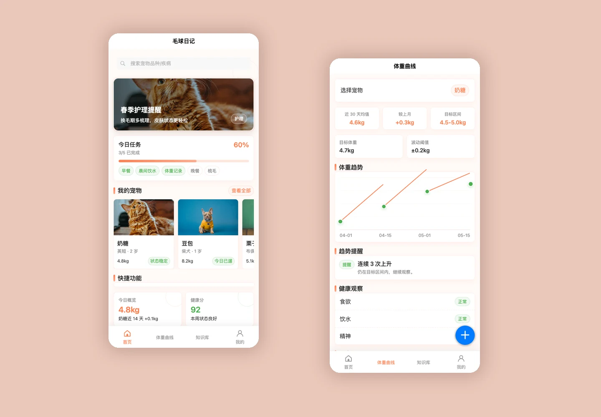

# 毛球日记

温暖友好的宠物健康管理前端原型，记录体重、提醒、照护与知识。

[在线体验](https://oyjw140814.github.io/furball-diary/docs/) · [嘉文的作品集](https://oyjw140814.github.io/)

## 页面

首页、体重曲线、健康报告、知识库、附近医院、我的，以及品种、文章、记录和账号等详情页。

## 源码恢复说明

原项目目录已不在原路径。本次从本人开发聊天中的 73 次补丁记录恢复了 22 个源码文件，随后补齐原先引用的 uni-ui 组件、日期选择适配、Vue 3 启动入口和本地图片，提供可运行的 H5 预览。

- 用 HBuilderX（Vue 3）打开项目根目录进行开发。
- `docs/` 为已编译 H5 预览，需用 HTTP 服务器访问（例如 `python3 -m http.server 8080`，再打开 `/docs/`）。
- 真实原始页面源码保留在 `pages/` 和 `components/`。

## 当前范围

使用演示数据的前端原型。医院、报告与账号同步入口不代表真实后端服务。uni-ui 为 DCloud 的第三方组件，来源：https://github.com/dcloudio/uni-ui ，版本 1.5.12。图片使用原开发记录中的 Unsplash 图片链接恢复，见 `IMAGE_SOURCES.md`。

作者：嘉文（oyjw140814）。个人学习创作，使用 AI 辅助设计与开发。
